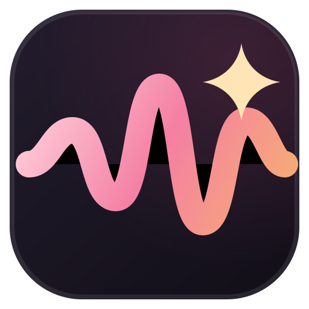

<div align="center">
  
  <h1>Voiceym</h1>
  <p><strong>A voice agent you can run anywhere, plus a private studio for voice cloning, voice design, dubbing, dictation and transcription.</strong></p>
  <p>
    <a href="#get-started">Get started</a> ·
    <a href="#how-to-use-voiceym">How to use it</a> ·
    <a href="#documentation">Docs</a> ·
    <a href="https://github.com/mnikhilsrikar2512/voiceym/releases/latest">Download</a>
  </p>
  <p>
    <a href="LICENSE"></a>
  </p>
</div>

## What Voiceym does

Voiceym runs on your own computer. Your voice, your recordings and your text
stay on your hardware unless you choose a cloud service.

| Talk | Create | Connect |
| :--- | :--- | :--- |
| A voice agent that listens, thinks and answers out loud | Clone a voice or design a new one | WebSocket agent API for any app |
| Interrupt it mid-sentence, like a real conversation | Dub videos with timed speech | Local speech API and MCP server for AI tools |
| Dictate anywhere with a floating widget | Stories, audiobooks and batch jobs | Phone companion apps (preview) |

## Get started

### 1. Install what Voiceym needs

You need [Git](https://git-scm.com/), [Node.js 22+](https://nodejs.org/),
[Bun](https://bun.sh/), [Python 3.11](https://www.python.org/) and
[uv](https://docs.astral.sh/uv/). For the voice agent you also need
[Ollama](https://ollama.com/), or another local or cloud language model
(see [step 4](#4-pick-a-language-model)).

| Hardware | Support |
|---|---|
| NVIDIA GPU (Windows / Linux) | CUDA acceleration |
| Apple Silicon | Metal (MPS) acceleration |
| No dedicated GPU | Works on the CPU, more slowly (about 5 GB of free disk) |
| Windows on ARM | Experimental, CPU only |
| Intel Mac | App UI only; connect to a backend on another machine |

An 8 GB computer can run the voice agent with the small models suggested
below; 16 GB gives you room for larger language models and voice cloning.

### 2. Get Voiceym

**From source** (best for trying the latest changes):

```bash
git clone https://github.com/mnikhilsrikar2512/voiceym.git
cd voiceym
bun install
bun run setup:api   # installs the Python backend and its dependencies
bun run dev         # starts the backend and the desktop app
```

**With the installer** (keeps your settings, projects and models on update):

```sh
# macOS / Linux
curl -fsSL https://raw.githubusercontent.com/mnikhilsrikar2512/voiceym/main/scripts/install.sh | sh
```

```powershell
# Windows (PowerShell)
irm https://raw.githubusercontent.com/mnikhilsrikar2512/voiceym/main/scripts/install.ps1 | iex
```

Add `--main` to build the latest source instead of a release, or `--uninstall`
to remove the app and keep your data. See the [installer details](docs/install/script.md)
and the platform guides: **[macOS](docs/install/macos.md) ·
[Windows](docs/install/windows.md) · [Linux](docs/install/linux.md) ·
[Docker](docs/install/docker.md)**.

### 3. First run

The first time Voiceym opens, a short setup downloads the default voice,
**Kokoro** (about 95 MB). Other models download only when you choose them in
**Settings → Models**, which shows each model's size and licence first.

### 4. Pick a language model

The voice agent needs a language model to think with. The easiest option is a
small local model through Ollama:

```bash
ollama pull qwen3:1.7b     # about 1.4 GB, good English and Indian languages
ollama pull llama3.2:1b    # about 1.3 GB, the lightest English option
```

Every model you pull appears in **Talk → Agent setup → Language model**. You
can also use LM Studio, llama.cpp, vLLM or a cloud provider from
**Settings → Models**.

## Commands by platform

Run every command from the repository folder unless it says otherwise.

### macOS (Apple Silicon)

```bash
# One-time tools
xcode-select --install
brew install git node bun uv ollama

# Get, set up and run
git clone https://github.com/mnikhilsrikar2512/voiceym.git
cd voiceym
bun install
bun run setup:api            # Python backend in .venv (managed by uv)
ollama pull qwen3:1.7b       # language model for Talk
bun run dev                  # desktop app with hot reload; starts the backend

# Browser instead of the desktop window (http://localhost:3901)
bun run dev:web

# Package a DMG/zip into electron/release/ (not published)
bun run dist
```

### Windows (PowerShell)

```powershell
# One-time tools
winget install --id Git.Git -e
winget install OpenJS.NodeJS.LTS
powershell -c "irm bun.sh/install.ps1 | iex"
powershell -c "irm https://astral.sh/uv/install.ps1 | iex"
winget install Ollama.Ollama
# Also: Visual Studio 2022 Build Tools with "Desktop development with C++"

# Get, set up and run (open a new PowerShell after installing the tools)
git clone https://github.com/mnikhilsrikar2512/voiceym.git
cd voiceym
bun install
bun run setup:api
ollama pull qwen3:1.7b
bun run dev

# Browser instead of the desktop window (http://localhost:3901)
bun run dev:web

# Package an NSIS installer into electron\release\ (not published)
bun run dist
```

To keep engine environments off `C:`, set `OMNIVOICE_ENGINES_DIR` first; see
the [Windows guide](docs/install/windows.md).

### iOS (iPhone and iPad companion, from a Mac)

The iOS app pairs with a running Voiceym desktop: on the computer, open the
sidebar, click the **Local device** pill and choose **Network**, then tap
**Scan QR code** in the app ([pairing guide](docs/mobile.md)). Building needs
full Xcode with an iOS 17+ simulator or device.

```bash
brew install xcodegen
mobile/ios/scripts/check-swift.sh build          # build the shared Swift package
mobile/ios/scripts/check-swift.sh test           # its unit tests
xcodegen generate --spec mobile/ios/Voiceym/project.yml
open mobile/ios/Voiceym/Voiceym.xcodeproj        # run the Voiceym scheme

# Command-line simulator build and UI tests
xcrun simctl list devices available              # pick an installed simulator
xcodebuild -project mobile/ios/Voiceym/Voiceym.xcodeproj -scheme Voiceym \
  -destination 'platform=iOS Simulator,name=iPhone 16' test
```

More detail: [mobile/ios/README.md](mobile/ios/README.md).

### Run the tests

Automated checks (the same ones CI runs) work on macOS, Windows and Linux:

```bash
bun run typecheck                                  # TypeScript
bun run lint                                       # oxlint
bun run test                                       # app unit tests + translation checks
uv run pytest tests/ -q                            # backend tests
uv run pytest backend/tests/ -q                    # backend isolated-session tests
uv run python scripts/check-docs-drift.py          # docs match the engines
```

On Windows, set `$env:HF_HUB_OFFLINE = "1"` (macOS/Linux:
`HF_HUB_OFFLINE=1`) before the pytest commands so no model downloads during
tests. The browser smoke tests are described in
[CONTRIBUTING](.github/CONTRIBUTING.md). Step-by-step manual checks for
macOS, Windows and iOS are in **[docs/TEST-CASES.md](docs/TEST-CASES.md)**.

## How to use Voiceym

Voiceym opens on **Home**, which asks what you would like to do and links each
task (talk, text to speech, cloning, voice design, dubbing, transcription,
audiobooks, stories) to its page with a one-line description. The sidebar is a slim
icon rail; rest the pointer on it to open the full menu, which lists every page
by name under **Create**, **Library** and **More** (hover an item to see what it
does), and move away to close it. Each page's own side panel collapses with its
panel button. Press **Cmd/Ctrl+K** anywhere to search for a page or action,
and **Cmd/Ctrl+1–9** to jump between workspaces.

### Talk to the voice agent

Open **Talk** from Home or the sidebar.

1. Open **Agent setup** and write the agent's **Instructions**, for example
   "You are a friendly English tutor. Keep answers short."
2. Pick a **Voice**, a **Language model** and a **Language**. Leave Language on
   **Auto** to have it follow whatever language you speak.
3. Press **Start talking** (or the space bar) and speak. The agent listens,
   answers out loud and shows the transcript.
4. Talk over it to interrupt; turn this off with **Let me interrupt it**. Turn
   on **Agent speaks first** if you want it to greet you.
5. Prefer typing? Use **Type a message** at the bottom of the conversation.

Changes to the setup apply to your next conversation. When a language can't be
spoken with a commercial-use voice, the agent still answers, in text, and tells
you why.

**Languages.** Talk understands speech in many languages. It speaks English, Hindi,
Spanish, French, Italian and Portuguese with Kokoro. To hear Tamil, Telugu,
Kannada, Malayalam, Bengali, Marathi and the other Indian languages, install
**Indic-TTS**, which needs no account (see [Voices and licences](#voices-and-licences)). For Hindi
and other Indian languages, `qwen3:1.7b` answers well on an 8 GB computer.

**Your own apps** can talk to the same agent over a WebSocket at
`ws://localhost:3900/v1/agent/ws`. The [voice agent guide](docs/voice-agent.md)
has the protocol and a short Python example.

### Clone a voice

1. Open **Clone** and add a short, clean recording of the voice (a few
   seconds of one person speaking, with no music), or record one in the app.
2. Check the transcript of the recording, give the voice a name and save it.
3. Type a script and press generate to hear it in the cloned voice.

Saved voices live in **Saved** and appear in every voice picker, including
Talk. English cloning for commercial work uses **Chatterbox** (install it once
from **Settings → Models**). Only clone a voice with the speaker's permission.

### Design a new voice

Open **Design** to create a voice that doesn't belong to anyone. Choose a
preset or describe it ("a calm older woman with a British accent"), adjust
traits such as age, pitch and style, and write a test line. Press **New seed**
for a different voice with the same traits, and **Save as voice profile** to
keep it.

### Browse ready-made voices

**Gallery** lists ready-made voices by category. Filter by age, gender, pitch,
accent or language, play a preview, and star the ones you like.

### Stories and audiobooks

* **Stories**: write or import a script, pick a default voice, and give
  individual lines their own voices to make a conversation or radio play.
* **Audiobook**: import a manuscript; chapter titles are detected
  automatically. Preview a chapter before rendering the whole book, add
  pronunciations for tricky names, and export MP3 or M4B with chapters and a
  cover.

Long renders keep going if you switch pages, and you can stop or resume them.

### Dub a video

1. Open **Dubbing** and drop in a video or audio file.
2. Voiceym transcribes it and translates it into the language you pick.
3. Edit the translated lines, the voice and the timing of each segment.
4. Generate the dubbed track and export it.

Use **Batch Dubbing** to dub many videos into several languages at once, with
a queue that shows each job's progress. Save dubbing work in **Projects** to
come back to it later.

### Transcribe and dictate

* **Transcribe**: upload an audio file, or press **Start dictation**, then
  stop to get the text. Past transcriptions stay in the history.
* **Dictate anywhere**: set a **Dictation shortcut** in **Settings → Models**,
  then press it in any app to speak and have the text typed for you.

### Automate with workflows

**Workflows** run the same steps over many inputs. Build a pipeline on the
canvas from steps such as **Speak**, **Transcribe**, **Translate**, **Convert**
and **Normalize**, then run it over up to 50 scripts or audio clips.

### More tools

* **Projects** collects your dubbing projects, stories, audiobooks, voices,
  transcriptions and exports in one searchable library.
* **Tools** has speech-rate fitting and audio file inspection.
* **Integrations** connects Voiceym to other apps and AI tools.

### Settings you'll use most

| Setting | What it's for |
|---|---|
| **Settings → Models** | Install, remove and switch voice, speech recognition and language models, read each model's licence, and set the dictation shortcut |
| **Settings → General** | App language and general behaviour |
| **Settings → Appearance** | Light or dark theme and layout |
| **Settings → Storage** | Where models and your files are kept, and how much space they use |
| **Settings → Privacy** | Analytics and what leaves your computer |
| **Settings → Diagnostics** and **Logs** | Help when something doesn't work |

## Voices and licences

The default voice is **Kokoro** (Apache-2.0, commercial use allowed), which
speaks English, Hindi and four more languages on any computer. Chatterbox (MIT)
adds commercial-use English cloning. **OmniVoice** (k2-fsa, 600+ languages)
covers cloning, voice design and dubbing in many more languages, but it is
**non-commercial (CC-BY-NC)** and opt-in from **Settings → Models**.

| Engine | Used for | Licence |
|---|---|---|
| **Kokoro** (default) | Speaking in English, Hindi and four more languages, on any computer | Apache-2.0, commercial use allowed |
| **Chatterbox** | English voice cloning | MIT, commercial use allowed |
| **Indic-TTS** | Speaking 12 Indian languages, including Tamil and Telugu, with no account | MIT, commercial use allowed |
| **Indic Parler-TTS** | Speaking 21 Indian languages, including Tamil and Telugu | Apache-2.0, commercial use allowed |
| **OmniVoice** (opt-in) | Cloning, design and dubbing in 600+ languages | CC-BY-NC, **non-commercial only** |

Indic-TTS installs with one click from **Model Catalogue** (about 2 GB), and
each language's voice downloads from GitHub the first time Talk needs it (about
1.5 GB, once). See the [Indic-TTS guide](docs/engines/indic-tts.md).

Indic Parler-TTS covers more languages, but its download is gated: accept its terms on
[Hugging Face](https://huggingface.co/ai4bharat/indic-parler-tts), add your
Hugging Face token in **Settings → Credentials**, then install it from **Model
Catalogue** (about 8 GB with its own environment). See the
[Indic Parler-TTS guide](docs/engines/indic-parler.md).

Voiceym never turns on OmniVoice for you, and Talk never uses it. If you use
Voiceym for paid or business work, stick to the commercial-use engines. The
full list is in the [features and engine catalog](docs/feature-catalog.md).

## For developers and AI tools

| Interface | Where |
|---|---|
| Voice agent over WebSocket | `ws://localhost:3900/v1/agent/ws` · [guide](docs/voice-agent.md) |
| Local speech API (speech, transcription, voices) | `http://localhost:3900` · [guide](docs/speech-platform.md) |
| MCP server for Claude Code, Cursor and other agents | `http://localhost:3900/mcp` · [guide](docs/mcp.md) |
| Code examples | [examples](examples/README.md) |

Coding agents can install the Voiceym skills with
`npx skills add mnikhilsrikar2512/voiceym`.

## Troubleshooting

| Problem | Try this |
|---|---|
| The app opens but nothing generates | Check **Settings → Models** for a model that is still downloading or failed |
| Talk says it can't reach the language model | Make sure Ollama is running (`ollama list`) and pick a model in **Agent setup** |
| The computer slows down while talking | Use a smaller model such as `qwen3:1.7b` or `llama3.2:1b`, and close other heavy apps |
| Dictation doesn't type anything | Allow microphone and accessibility access for Voiceym in your system settings |

More fixes are in the [troubleshooting guide](docs/install/troubleshooting.md)
and the [model download guide](docs/downloading-models.md).

## Documentation

| Need | Start here |
|---|---|
| Setup help | [Troubleshooting](docs/install/troubleshooting.md) · [Model downloads](docs/downloading-models.md) |
| Voice agent | [Browser and WebSocket guide](docs/voice-agent.md) |
| Models and audio quality | [Engine guides](docs/engines/README.md) · [Benchmarks](docs/benchmarks.md) |
| Integrations | [Local API](docs/speech-platform.md) · [MCP](docs/mcp.md) · [Examples](examples/README.md) |
| Phone companion (preview) | [iOS and Android apps](docs/mobile.md) |
| Testing | [Commands](#run-the-tests) · [Manual test cases (macOS, Windows, iOS)](docs/TEST-CASES.md) |
| Development | [Contributing](.github/CONTRIBUTING.md) · [Electron app](electron/README.md) · [Brand](docs/branding.md) |

## License and responsible use

Voiceym is open source under the [AGPL-3.0](LICENSE); see the
[license notice](LICENSE-NOTICE.md). Model weights, voices and generated output
have their own terms, which **Settings → Models** shows for each model. Only
clone a voice with the speaker's permission.
